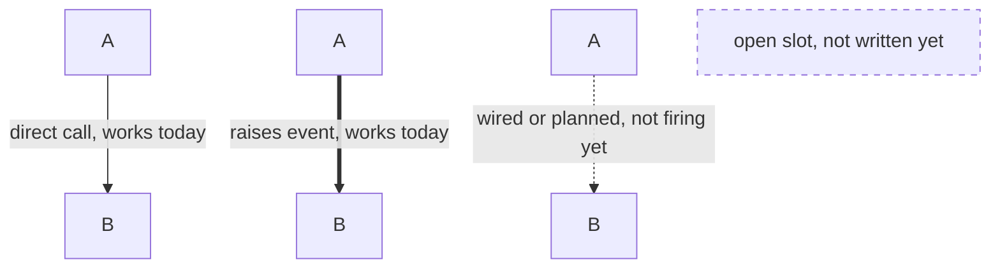
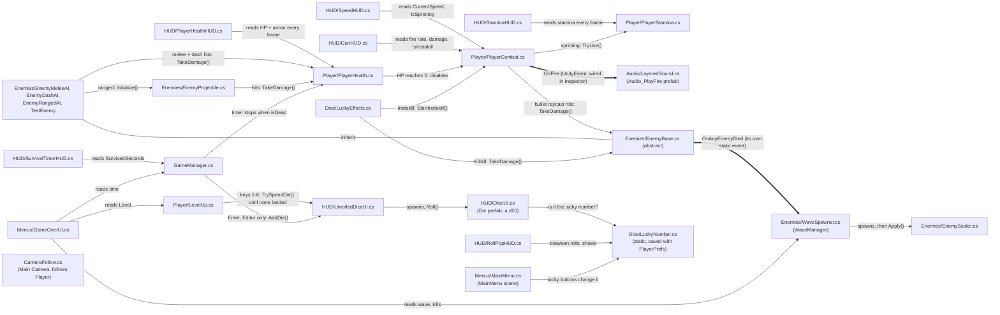
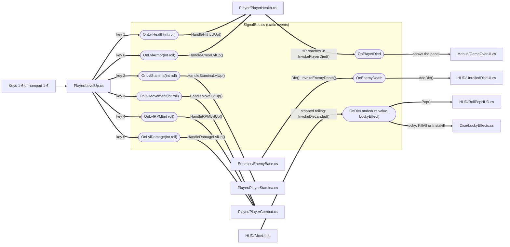

The  2026 Official Unity Game Jam will be a celebration of game development where veterans, hobbyists, students and game devs of all kinds will come together to do what they love most; make games.

Join the Unity community from November 5th to November 13th for a week-long game jam. You will have a full seven days to build a game around a theme revealed at the kickoff livestream, and a couple of extra days on top to get it submitted without panicking.

Throughout the duration of the jam, we invite you to hang with your fellow game devs in the Unity Discord.

Join the jam today to stay in the loop with updates and to guarantee you won't miss out on the festivities.

We look forward to jamming with y'all at the 2026 Official Unity Game Jam!

Check out last year's  Unity 20th Anniversary Game Jam page for inspiration and to get hype!

## How the scripts talk to each other

### Legend

### 1. Direct calls between scripts

### 2. SignalBus events

Every kill raises OnEnemyDeath, which puts a d20 in the tray. When a die stops rolling it raises OnDieLanded with its number and its lucky effect (None unless it rolled your lucky number). Keys 1-6 (or numpad 1-6) put every landed die into one stat, and each die raises that stat's event with its number. HUD scripts never listen to the stat events; they read each number from the script that owns it. Debug key (Editor only): Enter adds a die to the tray.

### 3. Scenes and prefabs

- Build order: scene 0 is `MainMenu`, scene 1 is the game (`SampleScene` for now). The menu's Play loads scene 1 and Esc or the game-over Main Menu button loads scene 0, by number rather than name, so a renamed or replaced level scene still works.
- `Prefabs/HUD.prefab` is the whole game Canvas (bars, speedometer, gun readouts, level badge, roll pop, timer, dice tray, game over). `Prefabs/GameManager.prefab` holds GameManager, SignalBus and LuckyEffects.
- To use them in another level scene, drop both prefabs in. Their scripts find the Player, GameManager and WaveSpawner on their own if nothing is dragged into those fields, and PlayerCombat adds a PlayerStamina to the player if it's missing.
